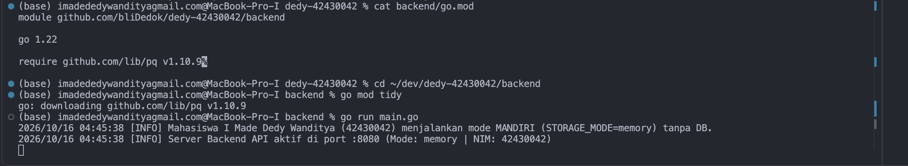
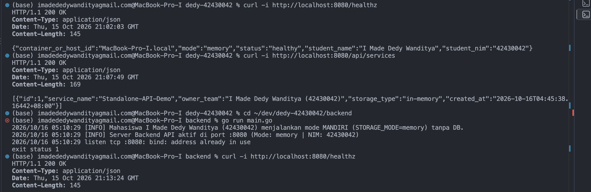
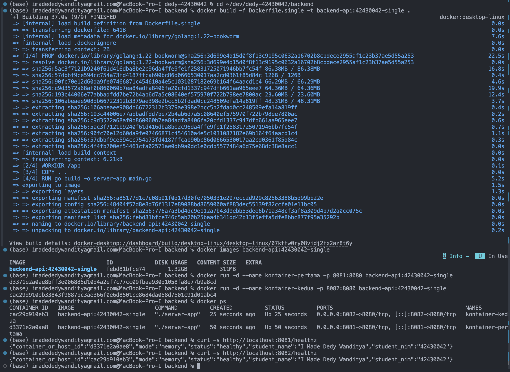
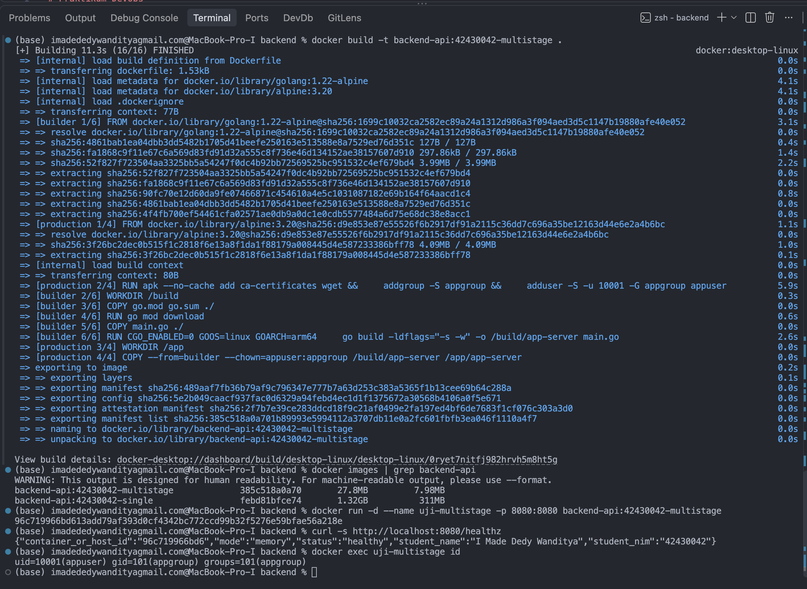

# Praktikum DevOps

- Nama: I Made Dedy Wanditya
- NIM: 42430042

## Tahap 1 — Menjalankan Aplikasi Native

Backend dijalankan langsung pada macOS menggunakan Go, dengan
STORAGE_MODE=memory.

### Cara menjalankan

Dari folder backend:
1. Jalankan `go mod tidy` untuk menyiapkan dependensi.
2. Jalankan `go run main.go` untuk memulai server pada port 8080.

### Hasil pengujian

- GET `/healthz` menghasilkan HTTP 200, status `healthy`,
  nama I Made Dedy Wanditya, dan NIM 42430042.
- Nilai `container_or_host_id` adalah `MacBook-Pro-I.local`.
- GET `/api/services` menghasilkan HTTP 200 dan data
  `Standalone-API-Demo` dengan storage_type `in-memory`.
- Proses kedua pada port 8080 gagal dengan pesan
  `bind: address already in use`.
- Server pertama tetap merespons setelah proses kedua gagal.
- Percobaan tambahan dengan `APP_PORT=8081 go run main.go`
  berhasil. Backend pada port 8080 dan 8081 sama-sama merespons.

### Analisis

Pada konfigurasi ini, kedua proses tidak dapat mendengarkan
pada alamat dan port TCP yang sama secara bersamaan.
Mengganti port proses kedua menjadi 8081 menghindari benturan.
Variabel lingkungan APP_PORT memungkinkan perubahan konfigurasi
tanpa mengubah kode sumber.

### Bukti

## Tahap 2 — Dockerfile Single-Stage

Image dibangun menggunakan Dockerfile.single dengan base image
golang:1.22-bookworm.

### Hasil pengujian

- Nama image: `backend-api:42430042-single`
- Image ID: `febd81bfce74`
- Disk Usage: `1.32 GB`
- Content Size: `311 MB`
- `kontainer-pertama` menggunakan pemetaan port `8081:8080`,
  dengan Container ID `d3371e2a0ae8`.
- `kontainer-kedua` menggunakan pemetaan port `8082:8080`,
  dengan Container ID `cac29d910eb3`.
- Kedua container berstatus Up.
- Kedua endpoint `/healthz` memberikan status `healthy`,
  nama I Made Dedy Wanditya, dan NIM 42430042.

### Analisis

Kedua container dapat menggunakan port internal 8080 karena
masing-masing memiliki lingkungan jaringan terpisah.
Akses dari Mac menggunakan port berbeda, yaitu 8081 dan 8082,
sehingga pemetaan port pada host tidak bentrok.

Image single-stage berukuran besar karena lingkungan Debian,
compiler Go, dependensi, dan berkas hasil build masih berada
dalam image akhir.

Docker menampilkan Disk Usage dan Content Size sebagai ukuran
yang berbeda. Disk Usage mencakup konten terkompresi dan hasil
ekstraksinya. Perbandingan dengan image multi-stage nantinya
akan menggunakan jenis ukuran yang sama.

### Bukti

## Tahap 3 — Optimasi Dockerfile Multi-Stage

Backend dibangun menggunakan dua tahap:
1. Builder menggunakan golang:1.22-alpine untuk mengompilasi aplikasi.
2. Production menggunakan alpine:3.20 untuk menjalankan hasil kompilasi.

### Perbandingan ukuran

| Image | Disk Usage | Content Size |
|---|---:|---:|
| backend-api:42430042-single | 1,32 GB | 311 MB |
| backend-api:42430042-multistage | 27,8 MB | 7,98 MB |

Image multi-stage memenuhi target ukuran di bawah 100 MB.

Perhitungan penghematan menggunakan kolom Disk Usage yang sama.
Dengan 1,32 GB ≈ 1320 MB:

Penghematan = (1320 − 27,8) / 1320 × 100% ≈ 97,89%.

Persentase ini merupakan perkiraan berdasarkan angka yang
dibulatkan pada tampilan Docker.

### Hasil pengujian

- Container bernama uji-multistage menggunakan pemetaan port 8080:8080.
- Endpoint /healthz memberikan status healthy dalam mode memory.
- Identitas yang ditampilkan: I Made Dedy Wanditya, NIM 42430042.
- Perintah docker exec uji-multistage id menampilkan
  uid=10001(appuser) dan gid=101(appgroup).

### Analisis

COPY --from=builder menyalin aplikasi hasil kompilasi dari tahap
builder ke tahap production. Compiler Go dan berkas pendukung
kompilasi tidak ikut disalin ke image akhir.

USER appuser menetapkan pengguna biasa untuk menjalankan aplikasi.
Hal ini membatasi hak akses aplikasi dibandingkan menjalankannya
sebagai root di dalam container.

Berkas go.mod dan go.sum disalin sebelum main.go agar layer
pengunduhan dependensi dapat digunakan kembali ketika hanya
kode aplikasi yang berubah.

GOARCH pada contoh modul disesuaikan dari amd64 menjadi arm64
agar hasil kompilasi cocok dengan lingkungan Docker linux/arm64
pada Mac yang digunakan. GOOS tetap linux.

### Bukti

