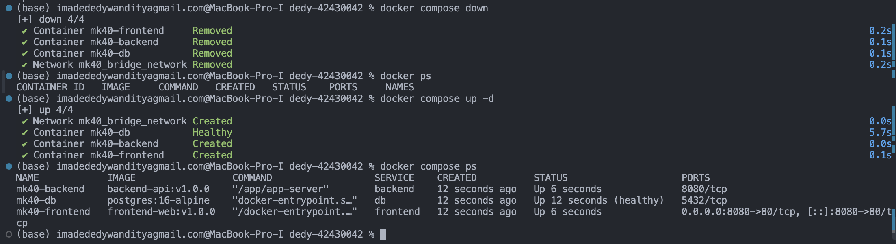
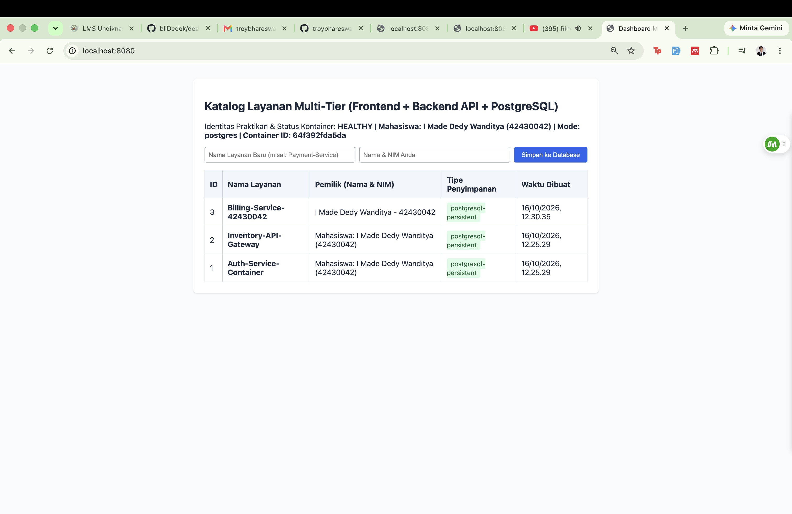
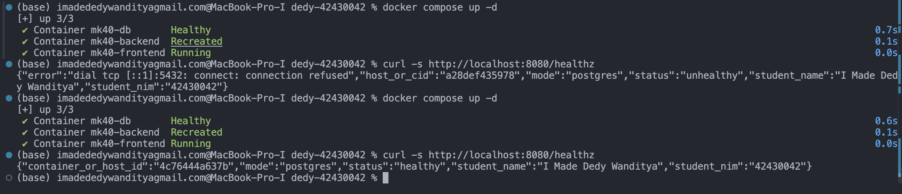
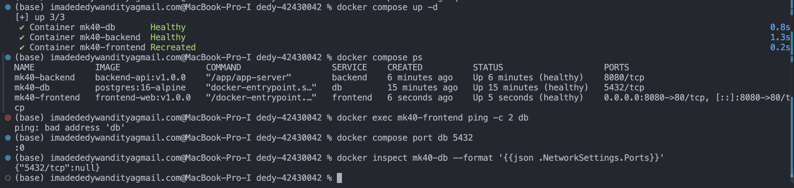

# Laporan Praktikum Modul 1 (Pertemuan 4): Kontainerisasi Docker & Orkestrasi Multi-Tier (Lab 1 & Lab 2)

- **Nama Mahasiswa**: I Made Dedy Wanditya
- **NIM**: 42430042
- **Kelas / Prodi**: S1 Teknologi Informasi – UNDIKNAS Denpasar
- **Tautan Branch GitHub**: https://github.com/bliDedok/dedy-42430042/tree/lab1-2/42430042-dedy
- **Nama Rekan Peer-Reviewer**: Salsabila Nur Shafa (42430040)

## Tabel Komparasi Eksperimen Individu

| Parameter | Tahap 1: Native | Tahap 2: Single-Stage | Tahap 3: Multi-Stage |
|---|---|---|---|
| Kebutuhan Go di host | Wajib menginstal Go SDK | Tidak wajib kompilasi dilakukan di Docker | Tidak wajib kompilasi dilakukan pada tahap builder |
| Ukuran image (Disk Usage) | Tidak menghasilkan image | 1,32 GB | 27,8 MB memenuhi target di bawah 100 MB |
| container_or_host_id | MacBook-Pro-I.local | d3371e2a0ae8 dan cac29d910eb3 | 96c719966bd6 |
| NIM pada respons aplikasi | 42430042 | 42430042 | 42430042 |
| Pengguna proses | Pengguna macOS yang menjalankan aplikasi | root secara default pada image | uid=10001(appuser), gid=101(appgroup) |
| Menjalankan dua instansi | Bentrok jika menggunakan alamat dan port yang sama berhasil dengan port berbeda | Berhasil menggunakan 8081:8080 dan 8082:8080 | Dapat menggunakan pemetaan port host berbeda pengujian Tahap 3 yang didokumentasikan menggunakan satu instansi |

Ukuran image dibandingkan menggunakan kolom Disk Usage yang sama.
Penurunan dari sekitar 1320 MB menjadi 27,8 MB adalah sekitar 97,89%.

Hostname dan Container ID pada tabel merupakan hasil pengujian
masing-masing tahap. Container ID dapat berubah ketika kontainer
dibuat kembali.

Pengujian langsung dua instansi dilakukan pada Tahap 2.
Pada Tahap 3, bukti yang dicatat adalah keberhasilan menjalankan
satu instansi, respons healthy, dan penggunaan appuser.

## Tahap 1 — Menjalankan Aplikasi Native

Backend dijalankan langsung pada macOS menggunakan Go, dengan
STORAGE_MODE=memory.

### Cara menjalankan

Dari folder backend:
1. Jalankan `go mod tidy` untuk menyiapkan dependensi.
2. Jalankan `go run main.go` untuk memulai server pada port 8080.

### Hasil pengujian

- GET `/healthz` menghasilkan HTTP 200, status `healthy`,
  nama I Made Dedy Wanditya, dan NIM 42430042.
- Nilai `container_or_host_id` adalah `MacBook-Pro-I.local`.
- GET `/api/services` menghasilkan HTTP 200 dan data
  `Standalone-API-Demo` dengan storage_type `in-memory`.
- Proses kedua pada port 8080 gagal dengan pesan
  `bind: address already in use`.
- Server pertama tetap merespons setelah proses kedua gagal.
- Percobaan tambahan dengan `APP_PORT=8081 go run main.go`
  berhasil. Backend pada port 8080 dan 8081 sama-sama merespons.

### Analisis

Pada konfigurasi ini, kedua proses tidak dapat mendengarkan
pada alamat dan port TCP yang sama secara bersamaan.
Mengganti port proses kedua menjadi 8081 menghindari benturan.
Variabel lingkungan APP_PORT memungkinkan perubahan konfigurasi
tanpa mengubah kode sumber.

### Bukti

## Tahap 2 — Dockerfile Single-Stage

Image dibangun menggunakan Dockerfile.single dengan base image
golang:1.22-bookworm.

### Hasil pengujian

- Nama image: `backend-api:42430042-single`
- Image ID: `febd81bfce74`
- Disk Usage: `1.32 GB`
- Content Size: `311 MB`
- `kontainer-pertama` menggunakan pemetaan port `8081:8080`,
  dengan Container ID `d3371e2a0ae8`.
- `kontainer-kedua` menggunakan pemetaan port `8082:8080`,
  dengan Container ID `cac29d910eb3`.
- Kedua container berstatus Up.
- Kedua endpoint `/healthz` memberikan status `healthy`,
  nama I Made Dedy Wanditya, dan NIM 42430042.

### Analisis

Kedua container dapat menggunakan port internal 8080 karena
masing-masing memiliki lingkungan jaringan terpisah.
Akses dari Mac menggunakan port berbeda, yaitu 8081 dan 8082,
sehingga pemetaan port pada host tidak bentrok.

Image single-stage berukuran besar karena lingkungan Debian,
compiler Go, dependensi, dan berkas hasil build masih berada
dalam image akhir.

Docker menampilkan Disk Usage dan Content Size sebagai ukuran
yang berbeda. Disk Usage mencakup konten terkompresi dan hasil
ekstraksinya. Perbandingan dengan image multi-stage nantinya
akan menggunakan jenis ukuran yang sama.

### Bukti

## Tahap 3 — Optimasi Dockerfile Multi-Stage

Backend dibangun menggunakan dua tahap:
1. Builder menggunakan golang:1.22-alpine untuk mengompilasi aplikasi.
2. Production menggunakan alpine:3.20 untuk menjalankan hasil kompilasi.

### Perbandingan ukuran

| Image | Disk Usage | Content Size |
|---|---:|---:|
| backend-api:42430042-single | 1,32 GB | 311 MB |
| backend-api:42430042-multistage | 27,8 MB | 7,98 MB |

Image multi-stage memenuhi target ukuran di bawah 100 MB.

Perhitungan penghematan menggunakan kolom Disk Usage yang sama.
Dengan 1,32 GB ≈ 1320 MB:

Penghematan = (1320 − 27,8) / 1320 × 100% ≈ 97,89%.

Persentase ini merupakan perkiraan berdasarkan angka yang
dibulatkan pada tampilan Docker.

### Hasil pengujian

- Container bernama uji-multistage menggunakan pemetaan port 8080:8080.
- Endpoint /healthz memberikan status healthy dalam mode memory.
- Identitas yang ditampilkan: I Made Dedy Wanditya, NIM 42430042.
- Perintah docker exec uji-multistage id menampilkan
  uid=10001(appuser) dan gid=101(appgroup).

### Analisis

COPY --from=builder menyalin aplikasi hasil kompilasi dari tahap
builder ke tahap production. Compiler Go dan berkas pendukung
kompilasi tidak ikut disalin ke image akhir.

USER appuser menetapkan pengguna biasa untuk menjalankan aplikasi.
Hal ini membatasi hak akses aplikasi dibandingkan menjalankannya
sebagai root di dalam container.

Berkas go.mod dan go.sum disalin sebelum main.go agar layer
pengunduhan dependensi dapat digunakan kembali ketika hanya
kode aplikasi yang berubah.

GOARCH pada contoh modul disesuaikan dari amd64 menjadi arm64
agar hasil kompilasi cocok dengan lingkungan Docker linux/arm64
pada Mac yang digunakan. GOOS tetap linux.

### Bukti

## Tahap 4 — Docker Compose dan Persistensi Database

Aplikasi dijalankan menggunakan tiga layanan:
- frontend: Nginx untuk menyajikan halaman web dan meneruskan permintaan API.
- backend: aplikasi Go dalam mode postgres.
- db: PostgreSQL untuk menyimpan data layanan.

### Hasil pengujian

Data Billing-Service-42430042 ditambahkan melalui formulir dengan
pemilik I Made Dedy Wanditya - 42430042 dan memperoleh ID 3.

Seluruh kontainer kemudian dihapus menggunakan `docker compose down`.
Hasil `docker ps` menunjukkan tidak ada kontainer yang berjalan.
Layanan dibuat kembali menggunakan `docker compose up -d`,
kemudian diperiksa dengan `docker compose ps`.

Setelah halaman web dimuat ulang:
- Container ID backend berubah dari 19ddc245cb53 menjadi 64f392fda5da.
- Status aplikasi kembali HEALTHY dengan mode postgres.
- Data Billing-Service-42430042 tetap ada dengan ID 3.
- Waktu pembuatan data tetap 16/10/2026, 12.30.35.
- Tipe penyimpanan tetap postgresql-persistent.

### Analisis

PostgreSQL menyimpan data pada named volume pgdata, dengan nama
mk40_pgdata_volume, yang dipasang ke /var/lib/postgresql/data.
Volume ini memiliki siklus hidup terpisah dari kontainer.

Perintah `docker compose down` tanpa opsi `-v` menghapus kontainer
dan jaringan, tetapi mempertahankan named volume. Saat layanan
dibuat kembali, kontainer PostgreSQL menggunakan volume yang sama
sehingga data Billing yang ditambahkan sebelumnya tetap tersedia.

Browser mengakses frontend melalui port 8080 pada laptop, yang
dipetakan ke port 80 Nginx. Nginx meneruskan permintaan /api/
dan /healthz ke backend:8080 melalui jaringan Compose.

Backend terhubung ke PostgreSQL menggunakan DB_HOST=db dan
DB_PORT=5432. Nama layanan backend dan db dapat ditemukan melalui
DNS internal Docker pada jaringan app-bridge-net.

Layanan db tidak memublikasikan port 5432 ke host. Komunikasi
backend ke database berlangsung melalui jaringan Docker.

### Bukti

## Tahap 5 — Troubleshooting Koneksi Database

### Pengujian error

Nilai DB_HOST pada layanan backend diubah sementara dari "db"
menjadi "localhost". Perubahan diterapkan menggunakan
`docker compose up -d`.

Pemeriksaan menggunakan `curl -s http://localhost:8080/healthz`
menghasilkan status unhealthy dengan pesan:

    dial tcp [::1]:5432: connect: connection refused

Alamat ::1 merupakan alamat loopback IPv6, sedangkan 127.0.0.1
yang dicontohkan dalam modul merupakan alamat loopback IPv4.
Keduanya merujuk ke lingkungan jaringan kontainer itu sendiri.

### Penyebab dan perbaikan

Setiap kontainer memiliki lingkungan jaringan tersendiri.
Karena itu, localhost di dalam kontainer backend menunjuk
ke backend itu sendiri, bukan ke kontainer PostgreSQL.

Tidak ada PostgreSQL yang mendengarkan pada port 5432 di
kontainer backend, sehingga koneksi ditolak. Kontainer database
sendiri tetap sehat, tetapi backend menggunakan alamat yang salah.

DB_HOST kemudian dikembalikan menjadi "db", yaitu nama layanan
PostgreSQL yang dapat ditemukan melalui DNS internal Docker.
Setelah menjalankan `docker compose up -d` kembali, endpoint
/healthz memberikan status healthy dengan mode postgres.

### Risiko penghapusan volume

Perintah `docker compose down` mempertahankan named volume,
sehingga data tetap tersedia saat kontainer dibuat kembali.

Namun, penambahan opsi `-v` juga menghapus named volume yang
dideklarasikan dalam proyek ini, termasuk volume pgdata.
Akibatnya, data PostgreSQL yang tersimpan di volume tersebut
akan hilang.

Jika database diinisialisasi ulang pada volume baru, init.sql
hanya mengisi data awal. Data tambahan seperti
Billing-Service-42430042 tidak otomatis kembali.

### Bukti

## LATIHAN MANDIRI INDIVIDU & AUDIT SILANG (PEER-REVIEW) DI GITHUB

### Analisis konfigurasi .env

Variabel POSTGRES_USER, POSTGRES_PASSWORD, POSTGRES_DB,
STUDENT_NIM, dan STUDENT_NAME disimpan dalam berkas .env.
Docker Compose menggunakan substitusi ${NAMA_VARIABEL}
untuk mengambil nilainya.

Berkas .env dimasukkan ke .gitignore agar kredensial lokal
tidak ikut di-commit dan diunggah ke GitHub. Berkas
.env.example menyediakan contoh konfigurasi dengan
placeholder password, tanpa menyertakan password asli.

### Analisis Dual Bridge Network

Konfigurasi awal pada Tahap 4 dikembangkan menjadi dua jaringan:

| Layanan | frontend-net | backend-net |
|---|---|---|
| frontend | Terhubung | Tidak terhubung |
| backend | Terhubung | Terhubung |
| db | Tidak terhubung | Terhubung |

Frontend dan database tidak berbagi jaringan. Karena itu,
hostname db tidak dapat ditemukan dari kontainer frontend,
sehingga pengujian ping menghasilkan `bad address 'db'`.

Aplikasi tetap dapat berfungsi karena frontend meneruskan
permintaan API ke backend melalui frontend-net. Backend
kemudian mengakses PostgreSQL melalui backend-net.
Port database tidak dipublikasikan ke host.

### Analisis Healthcheck

Healthcheck backend menggunakan wget untuk memeriksa
endpoint /healthz. Pada mode postgres, endpoint ini juga
memeriksa koneksi backend ke database.

Frontend menggunakan depends_on dengan kondisi
service_healthy agar saat layanan dijalankan melalui Compose,
frontend menunggu backend siap.

Healthcheck frontend juga ditambahkan untuk memeriksa
halaman Nginx, sehingga kesehatan ketiga layanan terlihat
pada hasil docker compose ps.

### Bukti pengujian

Ketiga kontainer berstatus healthy. Pengujian dari frontend ke
hostname db menghasilkan `bad address 'db'`, sesuai pemisahan
jaringan frontend dan database.

Perintah `docker compose port db 5432` pada versi Compose yang
digunakan menampilkan `:0`. Pemeriksaan tambahan menggunakan
`docker inspect` menghasilkan `{"5432/tcp":null}`, yang memastikan
port database tidak memiliki pemetaan ke port host.

## Bukti Audit Silang (Peer-Review) di GitHub

- **Tautan Pull Request (PR)**: https://github.com/bliDedok/dedy-42430042/pull/1
- **Reviewer**: Salsabila Nur Shafa
- **NIM Reviewer**: 42430040
- **Akun GitHub**: salsa-rgb
- **Status Review**: Approved
- **Tanggal Review**: 16 Oktober 2026

### Ringkasan Catatan Peer-Reviewer

Reviewer meninjau kode, konfigurasi Docker, README, dan bukti
pengujian yang dilampirkan. Catatan review menyatakan bahwa:

- Image multi-stage memenuhi target ukuran di bawah 100 MB
  dan menggunakan pengguna non-root.
- Bukti pengujian menunjukkan data tetap tersimpan setelah
  kontainer dibuat ulang.
- Penggunaan .env, .gitignore, dan .env.example sudah diterapkan.
- Jaringan frontend dan database dipisahkan, port database tidak
  dipublikasikan ke host, dan ketiga kontainer berstatus healthy.
- README memuat perbandingan eksperimen, analisis troubleshooting,
  serta bukti setiap tahap.

Reviewer menyetujui PR tanpa meminta perubahan pada review tersebut.